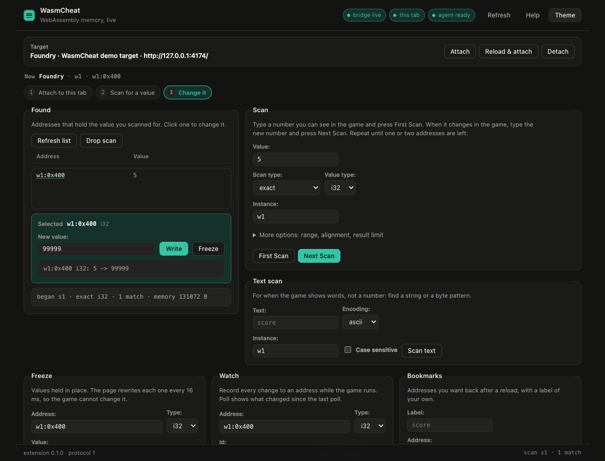
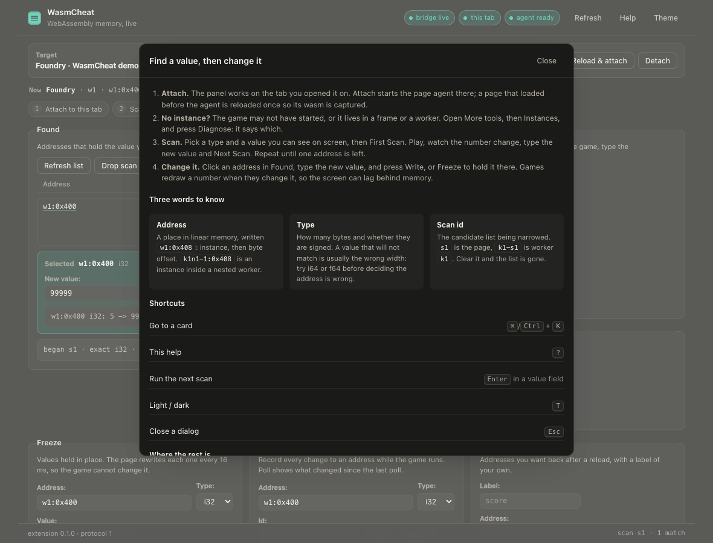
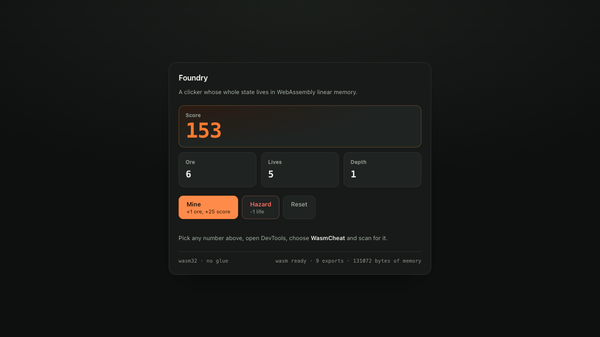

# WasmCheat

WasmCheat is a memory scanner for WebAssembly that runs in the browser. It attaches to a wasm app
in a Chrome tab, searches its linear memory, and lets you (or an MCP agent) read, write, freeze and
watch addresses, then patch a function or wrap it in JavaScript. Nothing native is involved: no
debugger flags, no DevTools protocol, no separate process holding the page.

Open the panel on a tab and it is yours to inspect; every mutation lands in an audit log.

Point it at programs you own or have written permission to test. See [Policy](#policy).


The panel is the human front end for the same calls an agent makes: attach, scan, narrow, change.

## The fastest path

```bash
npm install && npm run build
npm run demo        # serves and opens the demo game, prints the two things you need
```

Then load `packages/extension/dist` as an unpacked extension, open DevTools on the demo tab, and open
the WasmCheat panel. Type the score you see into **Scan**, press **First Scan**, and click the address
it finds to change it.

## Start here

| If you want to | Read |
| --- | --- |
| change a value in five minutes | [docs/QUICKSTART.md](docs/QUICKSTART.md) |
| learn the panel, card by card | [docs/PANEL.md](docs/PANEL.md) |
| drive it from an MCP agent | [docs/AGENT_GUIDE.md](docs/AGENT_GUIDE.md) |
| know what is proven and what is not | [docs/STATUS.md](docs/STATUS.md) |
| know why it looks and reads this way | [docs/DESIGN.md](docs/DESIGN.md) |

---

## What is in the box

| Package | Role |
| --- | --- |
| `packages/protocol` | The single shared contract: message envelopes, address format, value types, error codes, scan/hook/watch shapes. |
| `packages/page-agent` | Runs in the page's **MAIN world** and in every Web Worker. Patches `WebAssembly.instantiate*` / `new WebAssembly.Instance` to capture instances, then does the real work: memory access, scanning, freezing, watches, hooks, watchpoint instrumentation. |
| `packages/extension` | MV3 extension. Injects the page agent at `document_start`, relays RPC from the service worker, owns the WebSocket to the MCP server, and ships the DevTools panel and popup. |
| `packages/mcp-server` | Node 22 stdio MCP server. Exposes the `wasmcheat_*` tools, talks to the extension over a local WebSocket, writes the audit log. |
| `packages/demo-app` | A tiny C game compiled to a standalone wasm module, plus a hand-written loader. The test target. |

---

## Requirements

- Node 22+ (`engines` in `package.json`).
- Chrome 116+ (MV3 + `chrome.storage.session`).
- Optional, only to rebuild the demo wasm: an LLVM that knows `wasm32` (Emscripten's bundled
  clang counts; the build script finds it automatically). Without one, the committed
  `packages/demo-app/prebuilt/game.wasm` is used.

## Install and build

```bash
git clone <this repo> wasm-cheat && cd wasm-cheat
npm install
npm run build          # protocol, page-agent, extension, mcp-server, demo
npm run typecheck      # optional, same types the tests use
```

`npm run build` leaves two things you need:

- `packages/extension/dist/`: the unpacked extension (this directory *is* the extension root).
- `packages/mcp-server/dist/bin.js`: the MCP server binary.

## Load the extension

1. Open `chrome://extensions`.
2. Enable **Developer mode**.
3. **Load unpacked** → select `packages/extension/dist`.
4. Pin the extension; the toolbar icon shows whether the bridge is paired.

The extension connects to the MCP server on `ws://127.0.0.1:7331/extension` and reconnects with
backoff if the server is not running yet. The port is baked in at build time, so to use another
one: `WASMCHEAT_PORT=7400 npm run build` and start the server with the same value.

## The bridge, and why there is no token to paste

The MCP server listens on a local WebSocket and the extension dials it. That socket needs to know
which extension is real, so it is authenticated with a token the server mints into
`$WASMCHEAT_HOME/token` on first run.

You never see it. On the first connection the extension asks the server for the token over that same
socket (pairing), stores it, and presents it from then on. A wrong token is still refused with
`1008 bad bridge token`.

What keeps that socket honest:

- Pairing is answered only while no authenticated extension is connected, so a second client cannot
  ask for the token while the real extension holds the bridge.
- A connection only replaces the current one after it presents the token.
- Until a socket presents the token, everything it sends except `bridge.hello` and `bridge.pair` is
  dropped: it cannot answer a request, raise an event or write an audit line.
- An upgrade whose `Origin` is a web page (anything but `chrome-extension://`) is refused, so a site
  open in the browser cannot dial the port.

One case needs the field anyway, and it is in both the panel and the popup: **pairing is off**, because
the server was started with `WASMCHEAT_PAIRING=off` or with `WASMCHEAT_TOKEN` set. Then paste
`cat ~/.wasmcheat/token`. Pinning a token is the way to make the loopback socket useless to anything
else on the machine.

The panel pill says `bridge live · paired` when pairing worked, `token refused` with a red `!` badge
when the server rejected the stored token, and `waiting for pairing` when the server is not up yet.

## Point an MCP client at it

The server speaks MCP over stdio, so any client works. Claude Desktop style config:

```json
{
  "mcpServers": {
    "wasmcheat": {
      "command": "node",
      "args": ["/absolute/path/to/wasm-cheat/packages/mcp-server/dist/bin.js"],
      "env": { "WASMCHEAT_PORT": "7331" }
    }
  }
}
```

Or run it by hand while iterating:

```bash
npm start           # node packages/mcp-server/dist/bin.js, logs to stderr
```

### Drive it from a shell, without an agent

`scripts/wasmcheat-cli.mjs` is a one-shot MCP client, so you can poke a real site by hand:

```bash
node scripts/wasmcheat-cli.mjs tabs
node scripts/wasmcheat-cli.mjs attach 1234567 '{"reason":"manual check","waitSeconds":120}'
node scripts/wasmcheat-cli.mjs instances 1234567          # shorthand → {"tabId": …}
node scripts/wasmcheat-cli.mjs scan '{"tabId":1234567,"instanceId":"w1","type":"i32","mode":"exact","value":75}'
node scripts/wasmcheat-cli.mjs audit 40                   # last 40 audit entries
```

Every invocation spawns `dist/bin.js` itself, so the extension reconnects to the bridge each
time; set `WASMCHEAT_WAIT=40` to let it wait longer. Exit code 1 means the tool returned an
error (the message says which).

Environment knobs:

| Variable | Default | Meaning |
| --- | --- | --- |
| `WASMCHEAT_PORT` | `7331` | WebSocket port the extension dials. Must match the extension build. |
| `WASMCHEAT_HOST` | `127.0.0.1` | Bind address. Off loopback the server refuses to start unless `WASMCHEAT_PAIRING=off`, because pairing would hand the token to the network. |
| `WASMCHEAT_HOME` | `~/.wasmcheat` | Where `audit.jsonl` and `token` live. Created `0700`; both files are `0600`. |
| `WASMCHEAT_TOKEN` | read from `$WASMCHEAT_HOME/token` | Shared secret the extension must present. Minted on first run; set to mode `0600` on every start. Setting it turns pairing off. |
| `WASMCHEAT_PAIRING` | `on` (`off` when `WASMCHEAT_TOKEN` is set) | `off` refuses pairing, so only a pasted token connects. |
| `WASMCHEAT_RECONNECT_GRACE_MS` | `8000` | How long a tool call waits for the extension to dial back in (or to finish its hello) before reporting `NO_AGENT`. MV3 suspends the service worker after ~30s idle, so the first call after a pause usually arrives mid-reconnect. |
| `WASMCHEAT_CLANG` | auto-detected | LLVM used to compile `packages/demo-app/src/game.c`. |

---

## Architecture

```
┌─────────────────────────── Chrome tab (the target) ───────────────────────────┐
│  page scripts                     MAIN world                                  │
│  ───────────                      ──────────                                  │
│  app ↔ WebAssembly.Memory  ←──  page-agent: captured instances,               │
│                                     scan / read / write / freeze / watch /    │
│                                     export+import hooks                       │
│                                        ▲  postMessage (window)                │
│  isolated world                        │                                      │
│  relay.js  ────────────────────────────┘  channel handshake, RPC per id       │
└───────────────────────────────────────┬───────────────────────────────────────┘
                                        │ chrome.runtime.sendMessage
┌───────────────────────────────────────▼───────────────────────────────────────┐
│  extension service worker (sw.js)                                             │
│  · injects relay + page-agent on demand, one realm per frame and worker       │
│  · routes page.* RPC to the frame that holds the wasm                        │
└───────────────────────────────────────┬───────────────────────────────────────┘
                                        │ ws://127.0.0.1:7331/extension
┌───────────────────────────────────────▼───────────────────────────────────────┐
│  mcp-server (Node 22, stdio)                                                  │
│  · wasmcheat_* tools  · zod validation  · audit.jsonl                         │
└───────────────────────────────────────┬───────────────────────────────────────┘
                                        │ MCP (stdio)
                                    your agent
```

Why it looks like this:

- **The page agent has to run in the MAIN world.** `WebAssembly.Instance` objects only exist in
  the realm that created them; an isolated-world script sees nothing. The cost is that page
  scripts can also see the `postMessage` channel. The first `channelId` handshake of a document
  wins and results without that id are dropped, which stops cross-talk and blind spoofing, not a
  page that reads the traffic. The real trust boundary is the extension itself, which lives
  outside the page.
- **The agent is injected at `document_start`, before the app instantiates.** There is no API to
  enumerate pre-existing `WebAssembly.Instance` objects, so capture only works if the patch is in
  place first. If you attach to an already-loaded page, pass `reload: true` and the tab reloads
  with the agent already installed (the reload is audited).
- **The extension dials the server, not the other way round.** Only the extension can reach tab
  contents, so the MCP server is the listener and the extension is the client. A new
  connection takes over only after it presents the token; the old socket is then closed and its
  pending calls fail at once with `NO_AGENT`.
- **Scanning runs inside the page.** Snapshot passes loop over typed arrays in the page and only
  addresses plus a small sample travel back over the bridge, so a 16 MB heap scan is not a
  16 MB JSON round-trip.
- **Memory reads re-read `memory.buffer` on every call**, because `memory.grow` detaches the old
  buffer.

### Subframes

Games rarely live in the document you are looking at: a YouTube Playable, an itch.io embed or a
Unity wrapper runs in a **cross-origin iframe**, where a content script injected into the top
document cannot see it. Both content scripts are therefore registered with `all_frames: true`,
each frame's relay announces itself with its `frameId` and URL, and the service worker picks the
frame that actually captured a wasm instance (probing each one with `page.diagnose` when it has
to). `wasmcheat_list_tabs` shows the frames; `wasmcheat_attach` accepts `frameId` to override the
choice. A call always goes to exactly one frame (the top frame when none is known yet), never to
every frame at once.

### Web Workers

Unity, Godot 4 and most itch.io builds instantiate their module **inside a Web Worker**, where the
page realm's `WebAssembly` hook can never see it. The page agent therefore replaces `Worker` itself
and boots a second copy of itself inside each worker (prepending `importScripts('<extension>/dist/worker-agent.js')`
to a small blob wrapper), so worker instances are captured by the same registry, scan store and
hook store as page instances. `wasmcheat_list_workers` reports them, and their instance ids are
namespaced by the worker that owns them (`k1-1`).

The wrapper is installed **at `document_start`**, before the page's own scripts, because a worker
created earlier than the wrapper is invisible forever, and game loaders create their worker in their
first script, which is exactly the losing side of that race. The agent cannot build an extension
URL on its own, so the isolated-world relay publishes it on `document.documentElement`
(`data-wasmcheat-agent`) synchronously, and the wrapper resolves it per construction; if the
attribute is ever missing the page gets a plain, uninstrumented worker rather than a broken one.

A worker that starts a worker is captured the same way: each worker agent installs that wrapper too,
so the grandchild's ids chain the names (`k1n1-1` belongs to the worker `k1` started), and a call for
one is routed down the chain rather than refused. The e2e suite covers a page → worker → worker
chain in `nested.html`.

### The DevTools panel

Open DevTools → **WasmCheat**. The panel is a second front end on the same dispatcher the WebSocket
uses (`wasmcheat.panel.call` → `handleBridgeRequest`), so it cannot skip
the audit log. The service worker answers that message only from the extension's own pages.

It follows the order you work in: what you are attached to, the scan, the hits, what you can do to one
address, then the advanced tooling and the raw console. The header keeps the three facts you need on
screen (target, tab, agent), and the `Now` line reads tab → instance → address, so a write is
never aimed at something you have forgotten about.

- The first screen is the loop (tab, scan, hits, one address). Clicking a hit opens an editor under
  the list with **Write** and **Freeze**, and the scan card hides the fields the chosen mode does not
  use. A steps strip marks where you are, and <kbd>Enter</kbd> in a
  value field runs whichever scan is next.
- Every tool is a form: freeze, watch, bookmarks, a hex **memory viewer** (16 bytes per row,
  Earlier/Later, **Follow pointer**, and any address you click jumps the dump to it), and under
  **More tools** the rest: workers, pointer scan and resolve, speed hack, saved lists, watchpoints,
  patches, hooks, the live audit view and a raw RPC console.
- <kbd>⌘</kbd>/<kbd>Ctrl</kbd> + <kbd>K</kbd> opens a palette over every card, filtered as you type.
  `?` opens the built-in help, `T` switches light and dark.
- Empty lists name the cause and the next action instead of saying "no data", and a refused call shows
  the error code next to the sentence that fixes it.





The demo target is a game window rather than a copy of the tool, so the two are never confused:



### Three WebAssembly facts that shape the tool

- **Imports are bound at instantiation.** A running instance can never gain a replaced import.
  Import hooks are therefore queued as rules that our patched `WebAssembly.instantiate` applies
  to the imports object *before* the engine sees it, and the created hook reports
  `pending: true` for the live instance. `importPatchability` in `wasmcheat_list_instances` says
  `next-instantiation` or `none`, never a fake `live`.
- **An export patch only reaches callers that read the property per call.** Replacing
  `instance.exports.get_score` works if the app calls `instance.exports.get_score()`. Emscripten's
  glue caches the function on first call (`_get_score = wasmExports['get_score']`), so patched
  exports are invisible to it. That is exactly why the demo ships a hand-written loader.
- **A store reports nothing.** No engine hook exists for "this instruction wrote this byte", so
  a watchpoint cannot be attached to a compiled module at all. `wasmcheat_find_writes` and
  `wasmcheat_find_reads` therefore rewrite the binary before it compiles: every store gains a
  gated call back into the page agent, and every load gains a gated identity call that reports
  the address it is about to touch. See [Watchpoints](#watchpoints-asking-who-touched-an-address).

---

## Nothing to approve, and everything logged

There is no approval prompt. Opening the panel on a tab is the decision: you are looking at that
page, in DevTools, on purpose. Everything follows from that:

- **The panel drives the tab it lives on.** Opened from DevTools it is the inspected tab; opened
  as a plain page it takes the tab in front. There is no tab picker, and the toolbar popup is only
  a status card.
- **Tools default to the tab in front.** `tabId` is optional on every MCP tool: an agent that does
  not pass one gets the tab you are looking at, and `wasmcheat_list_tabs` exists only for the rare
  case of a second tab.
- **Attach is one click, and it can heal itself.** If the page has no agent yet, attach injects it;
  if the app started before the agent existed, attach reloads the tab once, says so in its note,
  and keeps going.
- **The audit log is the record.** Every mutation is reported by the extension from a single
  funnel (`callTab`), so a human clicking Freeze and an agent calling `wasmcheat_freeze` produce the
  same line: tab, address, and `before -> after` for writes. Writes, freeze set/clear, watch
  add/remove, scan begin/narrow/drop, text scan, hook add/enable/remove, patch add/remove/clear,
  watchpoint arm/stop/clear, pointer scan, bookmark add/remove/clear, speed changes and reloads.
  Saved scan lists and attach/detach are recorded by the MCP server, because they are not page
  calls. Reads, `scan_results`, `pointer_resolve`, listing calls and watch polls are not logged:
  they change nothing and would bury the writes.
- **Lines land in `$WASMCHEAT_HOME/audit.jsonl`** (append-only, timestamped) and can be read back
  with `wasmcheat_audit`.

The page agent still runs in the MAIN world, so a hostile page can see its channel. The trust
boundary is the browser extension itself plus `127.0.0.1`-only bridging, not secrecy from the page.

---

## Tool reference

Addresses are `"<instanceId>:<offset>"`, e.g. `w1:0x408` or `w1:1032`. `instanceId` comes from
`wasmcheat_list_instances`; offsets may be hex or decimal.

| Tool | Purpose |
| --- | --- |
| `wasmcheat_list_tabs` | Tabs the extension can see, with agent state. Every other tool defaults to the tab in front. |
| `wasmcheat_attach` | Start (or heal) the page agent and return the instances. |
| `wasmcheat_detach` | Forget the tab and drop the agent it injected. |
| `wasmcheat_list_instances` | Instances, memory sizes, exports, import patchability. |
| `wasmcheat_scan` | Snapshot filtered memory, or narrow an existing scan. |
| `wasmcheat_scan_text` | Find a string or byte pattern (ascii / utf8 / hex bytes). |
| `wasmcheat_scan_results` | Page through hits of a scan. |
| `wasmcheat_scan_drop` | Free a scan session. |
| `wasmcheat_saved` | `list` / `save` / `open` / `delete` named scan lists that survive a reload. |
| `wasmcheat_bookmark` | `list` / `add` / `remove` / `clear` a named address list (label → address), kept per site. |
| `wasmcheat_list_workers` | Web Workers, including module workers, that own their own wasm. |
| `wasmcheat_pointer_scan` | Find pointer paths whose last offset lands on an address. |
| `wasmcheat_pointer_resolve` | Follow a saved path and return the current address. |
| `wasmcheat_read` | Typed values (optionally an array) or raw bytes as hex. |
| `wasmcheat_write` | One typed write, returns before → after, audited. |
| `wasmcheat_freeze` | `set` / `clear` / `list` frozen addresses. |
| `wasmcheat_watch` | `add` / `remove` / `list` / `poll` change events. |
| `wasmcheat_hook` | `add` / `list` / `enable` / `remove` export and import hooks. |
| `wasmcheat_find_writes` | Which function writes to an address? Reloads with an instrumented module. |
| `wasmcheat_find_reads` | Which function reads an address? Same mechanism, load probes instead of store hooks. |
| `wasmcheat_trace` | `arm` / `status` / `poll` / `clear` / `stop` for a watchpoint (`kind`: `read` or `write`). |
| `wasmcheat_patch` | `add` / `list` / `remove` / `clear` function-body patches: stub a function with a constant return. |
| `wasmcheat_speed` | Speed hack: scale the page clock (0–20x, `0` freezes it), or `reset`. |
| `wasmcheat_diagnose` | Why is the instance list empty? Counts, frames, wasm URLs, one-line hint. |
| `wasmcheat_audit` | The most recent audit entries. |

### Discovering and attaching

```jsonc
// wasmcheat_list_tabs
{}
// → [{"tabId": 1310636703, "title": "Foundry", "url": "http://127.0.0.1:4173/", "active": true, …}]

// wasmcheat_attach
{ "tabId": 1310636703, "reason": "find the score and patch get_score", "waitSeconds": 60 }
// → {"pageAgent": {...}, "instances": [
//      {"id": "w1", "memory": {"byteLength": 131072, "growable": true},
//       "exports": [{"name": "tick", "kind": "function", "arity": 1}, …],
//       "importPatchability": "next-instantiation"}]}
```

`reload: true` reloads first, for pages that loaded before the extension did.

### Scanning

Start with `exact` (or `changed` for a value you don't know) to take a snapshot; then narrow that
snapshot with `changed` / `unchanged` / `increased` / `decreased` as the value moves.

```jsonc
// wasmcheat_scan: first pass
{ "tabId": 1310636703, "instanceId": "w1", "type": "i32", "mode": "exact", "value": 75 }
// → {"scanId": "s1", "matchCount": 2, "sample": [...], "memoryByteLength": 131072}

// wasmcheat_scan: narrow, after the app changed the value
{ "tabId": 1310636703, "instanceId": "w1", "type": "i32", "mode": "changed", "scanId": "s1" }
// → {"scanId": "s1", "matchCount": 1, …}

// wasmcheat_scan_results
{ "scanId": "s1", "offset": 0, "limit": 20 }
// → {"hits": [{"address": "w1:0x408", "value": 100}], "total": 1}
```

```jsonc
// wasmcheat_scan: comparison operators and deltas work in any pass
{ "mode": "less", "value": 100 }              // also: not-equal, greater, less-or-equal,
                                              // greater-or-equal, between (+ "value2"), increased-by,
                                              // decreased-by, unchanged
// wasmcheat_scan_text: strings and byte patterns
{ "tabId": …, "instanceId": "w1", "text": "combo", "encoding": "ascii", "caseSensitive": false }
{ "tabId": …, "instanceId": "w1", "text": "deadbeef", "encoding": "bytes" }
// → {"encoding": "ascii", "matches": 3, "sample": [{"address": "w1:0x210", "preview": "…"}]}
// wasmcheat_saved: keep a narrowed list across a reload
{ "tabId": …, "action": "save", "name": "player health", "scanId": "s1" }
{ "tabId": …, "action": "list" }                       // [{ "name", "matchCount", "mode", "type", "createdAt" }]
{ "tabId": …, "action": "open", "name": "player health" } // → { "scanId": "s2", "instanceId": "w1", … }
```

A scan session lives in page memory, so it dies with the page, and a game that reloads, or an agent
that reloads the tab to install a hook, is the normal case. Naming a list stores the surviving
addresses (plus the values they held) in the page's own `sessionStorage`: it survives a reload of
that tab, does not leak into another tab, and the re-opened list narrows exactly like a fresh scan
(`changed`, `increased`, …). The DevTools panel has the same four actions under **Saved scans**.

Parameters: `type` (i8…f64), `mode`, `value` (and `value2` for `between`), `tolerance` (floats,
defaults to `max(|value|·1e-6, 1e-6)`), `alignment` (defaults to the type width; `1` catches
unaligned data), `from` / `to` (byte bounds of the scan; omit for the whole memory), `maxResults`
(default 250 000, sets `truncated`), and `scanId` to narrow. The page-layer call spells the bounds
`range: {start, end}`: that is what the panel sends; the MCP tool takes `from` / `to` and builds it.

### Reading, writing, freezing, watching

```jsonc
{ "tabId": …, "address": "w1:0x408", "type": "i32" }              // wasmcheat_read → values: [100]
{ "tabId": …, "address": "w1:0x408", "length": 16 }               // → hex: "64000000…"
{ "tabId": …, "address": "w1:0x408", "type": "i32", "value": 999999 }  // wasmcheat_write → before/after

{ "tabId": …, "action": "set", "address": "w1:0x400", "type": "i32", "value": 999 }  // wasmcheat_freeze
{ "tabId": …, "action": "clear", "freezeId": "f1" }
{ "tabId": …, "action": "list" }

{ "tabId": …, "action": "add", "address": "w1:0x408", "type": "i32" }  // wasmcheat_watch
{ "tabId": …, "action": "poll", "limit": 50 }   // → [{"address": "w1:0x408", "before": 100, "after": 4242, …}]
```

Freezes re-write the value every 16 ms, so the app cannot win. Watches sample every 50 ms and
buffer up to 200 events per watch; `poll` drains them (MCP is request/response: there is no
server push, so the agent polls).

### Hooking exports and imports

The body is compiled as `function(args, ctx)`: `args` is the argument array, `ctx.call(nextArgs?)`
runs the original, and the return value replaces the result (return nothing to pass it through).

```jsonc
// Double every score read, live, no reload.
{ "tabId": …, "action": "add", "instanceId": "w1", "target": "export", "name": "get_score",
  "body": "return ctx.call(args) + 1000000;", "note": "demo: show a live export patch" }

// Rewrite arguments on the way in.
{ "tabId": …, "action": "add", "instanceId": "w1", "target": "export", "name": "take_damage",
  "body": "ctx.call([0]);" }

// Imports apply at the next instantiation (WebAssembly binds them then).
{ "tabId": …, "action": "add", "instanceId": "w1", "target": "import", "name": "env.log",
  "body": "console.log('mined', args[0]); return ctx.call(args);" }

{ "tabId": …, "action": "enable", "hookId": "h1", "enabled": false }
{ "tabId": …, "action": "remove", "hookId": "h1" }
```

Hooks are recorded per instance and can be stacked; disabling or removing one restores the app's
original behaviour immediately. If the page's CSP forbids eval, `add` returns `HOOK_EVAL_BLOCKED`;
pass a declarative `fallback` instead (`{"mode": "replace-return", "value": 42}`,
`{"mode": "offset-result", "value": 1000}`, or `{"mode": "passthrough"}`).

---

## Watchpoints: asking "who touched this address?"

`wasmcheat_find_writes` and `wasmcheat_find_reads` are Cheat Engine's breakpoints, translated to
wasm:

```jsonc
{ "tabId": …, "address": "w1:0x408", "type": "i32" }
// find_writes → {"installed": true,
//   "hits": [{"kind": "write", "funcIndex": 3, "funcName": "mine", "previous": 75, "value": 100, …}],
//   "functions": [{"name": "mine", "funcIndex": 3, "hits": 12}]}

{ "tabId": …, "address": "w1:0x408", "type": "i32" }   // wasmcheat_find_reads
// → {"hits": [{"kind": "read", "funcName": "get_score", "value": 25, …}],
//    "functions": [{"name": "get_score", "hits": 331}, {"name": "tick", "hits": 4}]}
```

Reads answer a different question than writes: the writer tells you where a value comes from, the
reader tells you what the value is *used for*. For a health bar, the reader is the code that
decides the player dies.

How it works, because the constraint is the interesting part:

1. WebAssembly gives the host no notification when a `store` executes, and a compiled module
   cannot be modified. So the watchpoint has to be in the binary *before* the engine sees it.
2. The tool arms the watchpoint, then reloads the tab itself, because an arm only counts before the module is
   instantiated. Your module is rewritten as it streams past one
   mutable `i32` global, one import (`__wasmcheat.on_store` or `on_read`), one export
   (`__wc_arm`), and then:
   - **writes**: after every store instruction, `global.get flags; if (flags) { on_store(funcIndex) }`.
     A store leaves the stack empty, so appending is always safe.
   - **reads**: before every load, `call probe`, where the probe is `(i32) -> (i32)`:
     `global.get flags; if (flags) { on_read(addr + offset, funcIndex) }; addr`. The address is
     already on the stack, the probe hands it back unchanged, and no stack analysis is needed at
     all. One probe is generated per (function, memory offset) pair; the offset has to be baked
     in because compilers address globals as `i32.const 0; i32.load offset=1032`.
3. `funcIndex` is a constant per call site, which is the attribution: it names the function that
   performed the access. The page agent diffs the watched address on every callback and records
   the hit with the value before and after.
4. `wasmcheat_trace {action: "stop"}` removes the rewriting for the next reload, and nothing
   stays behind in the page.

Honest limits:

- The watchpoint needs a reload; a module that is already compiled can never be instrumented.
  When you arm a live page, the status says so instead of pretending.
- The gated check costs one global read and a branch per store, and one call per load, even when
  disarmed; while armed every access is a call into the page agent, which is slower than running
  free. Only the watchpoint you asked for is instrumented: `find_reads` leaves stores untouched
  and vice versa. That is the same trade Cheat Engine makes with a hardware breakpoint.
- `memory.copy` / `memory.fill` are reported as writes only: they take a length on top of the
  stack, so a `(i32) -> (i32)` probe would see the length instead of an address.
- Atomic (thread) loads and SIMD are rejected by the rewriter rather than silently missed; a page
  that uses them reports the rewrite as unsupported instead of returning an empty hit list.
- Functions the module does not export appear as `wasm-function[12]`. That is all the identity
  the engine has; the index still lets you map it to a disassembly.
- Modules using SIMD (`0xFD`) or atomics (`0xFE`) are rejected with `UNSUPPORTED` rather than
  rewritten half-way. Everything Emscripten, Unity and clang emit today (element segments,
  start functions, indirect calls) is handled.

## Patching a function body

Hooks can only reach the surface a module exposes: imports and exports. Everything a module keeps to
itself (the damage routine, a cooldown, a check) has no seam to wrap, so the only way to switch it
off is to change the code. `wasmcheat_patch` does exactly that, in the same rewrite pass the
watchpoints use:

```jsonc
{ "tabId": …, "action": "add", "target": "take_damage", "mode": "stub", "value": 0 }
// → {"patch": {"id": "p1", "target": "take_damage", "mode": "stub", "value": 0,
//              "applied": true, "funcIndex": 5, "applications": 1}, …}
```

- `mode: "stub"` replaces the body with `const value` (default 0) of the function's result type, so
  `take_damage` still returns, and no longer does anything. Every caller is affected, because the
  stub is the function.
- `mode: "empty"` is for void functions: the body becomes a bare `return`.
- `target` is an export name, or `wasm-function[N]` for a function the module does not export;
  `wasmcheat_list_instances` shows both spellings next to each function it reports.
- The stub lives in the binary, so it also reaches callers that cached an export reference, which is
  the one thing a JS hook can never do.
- Patches persist across reloads (`sessionStorage`, per origin, exactly like arming a watchpoint) and
  stay until `remove` / `clear`, which reload the tab so the original body comes back.
- `applied` is false until a module has been instantiated with the patch: a compiled module can never
  be edited. The tool waits for the instantiation the reload triggers, so `applied: true` means the
  code you are talking to is the code you patched.

The rewriter refuses to guess: SIMD, atomic, and multi-value result functions are reported as
unsupported instead of being stubbed into a module that no longer validates.

## Demo walkthrough

The demo is a small C clicker (`packages/demo-app/src/game.c`) whose state lives in linear memory:
lives at `0x400`, level at `0x404`, score at `0x408`, ore at `0x40C`.

```bash
npm run build
npm run serve -w @wasmcheat/demo-app     # http://127.0.0.1:4173/
```

Open it, load the extension, start the MCP server, then an agent session looks like this:

```
agent: wasmcheat_list_tabs {}
       → one tab, "Foundry", active: true
agent: wasmcheat_attach {}
       → instances: [w1, 131072 bytes]   (no tabId: the tab in front is the demo)
agent: wasmcheat_scan { "tabId": …, "instanceId": "w1", "type": "i32", "mode": "exact", "value": 75 }
       → scanId s1, 2 matches
       (press Mine a few times in the page between passes)
agent: wasmcheat_scan { "tabId": …, "instanceId": "w1", "type": "i32", "mode": "changed", "scanId": "s1" }
       → 1 match
agent: wasmcheat_scan_results { "scanId": "s1" }
       → {"hits": [{"address": "w1:0x408", "value": 100}]}
agent: wasmcheat_write { "tabId": …, "address": "w1:0x408", "type": "i32", "value": 999999 }
       → the score in the page changes, no reload
agent: wasmcheat_freeze { "tabId": …, "action": "set", "address": "w1:0x400", "type": "i32", "value": 999 }
       → Hazard no longer takes lives
agent: wasmcheat_hook { "tabId": …, "action": "add", "instanceId": "w1", "target": "export",
                        "name": "get_score", "body": "return ctx.call(args) + 1000000;" }
       → every painted score jumps by a million
agent: wasmcheat_audit { "limit": 20 }
       → the attach, the write, the freeze and the hook, with addresses and values
```

`window.__foundry` exposes `pause()`, `resume()` and `snapshot()` so a scan can target a value
that is not moving. The automated test does exactly that.

---

## Tests

```bash
npm test           # build → vitest (147 unit) → playwright (22 end-to-end)
npm run test:unit  # page agent: memory, registry, scanner, hooks, trace, rewriter (no browser)
npm run test:e2e   # real Chromium, real extension, real MCP stdio client
```

The end-to-end suite (`tests/e2e/demo.spec.ts`) launches Chromium with the unpacked extension,
serves the demo, connects a real MCP client to `dist/bin.js`, and then, in order:

1. lists the tab, and proves a tool with no `tabId` answers for the tab in front;
2. attaches without any prompt and exposes the instance;
3. pauses, resets, mines three times, scans for 75, narrows `unchanged` then `changed` to `w1:0x408`;
4. writes 123456 and asserts the page DOM changes without a reload;
5. freezes lives at 999 and clicks Hazard;
6. reads typed values and raw bytes, watches the address, and asserts a `123456 → 4242` event;
7. adds a `get_score` hook, asserts the painted score grows by 1 000 000, then disables, re-enables
   and removes it, asserting the original behaviour at each step;
8. performs every kind of mutation and asserts each lands in the one audit funnel;
9. arms a write watchpoint, reloads, mines, and asserts `mine` is named as the writer of `0x408`;
10. arms a read watchpoint and asserts `get_score` is named as the reader;
11. stubs `get_score` with `wasmcheat_patch`, reloads, asserts the page paints 777 while a
    neighbouring export still works, then removes the patch;
12. scans for a pointer chain and resolves it back to the score address;
13. drives a worker the page creates, and asserts the worker is listed and its death reported;
14. detaches, then proves the next call re-attaches on its own;
15. opens the demo inside a genuinely cross-origin iframe and drives it there;
16. drives the tab from the DevTools panel alone, with no agent and no popup;
17. saves a scan list, reloads the tab and keeps narrowing the restored list;
18. attaches to a page whose wasm lives in a Web Worker, writes to the worker's memory, scans and
    narrows there, and sees the worker's own published state change;
19. bookmarks the score address, reloads, reads through the remembered address and forgets it;
20. measures the score clock at 1x and 4x (`wasmcheat_speed`), freezes it at 0 and resets it, and
    asserts the change reached the audit log;
21. opens `nested.html`, where a worker starts the game worker, and drives `k1n1-1` through two
    worker hops: list it, click Mine, write to its memory, watch the page repaint, then scan it;
22. wipes the stored token and proves the extension pairs with the bridge again on its own, with no
    paste and no human step.

Costs and gotchas: one browser and one bridge port, so the suite runs with a single worker and
fails fast if the port is already taken (it picks `7399` by default so it does not collide with a
server you have running).

## Layout

```
scripts/demo.mjs                    `npm run demo`: serves and opens the demo, prints what to do next
scripts/wasmcheat-cli.mjs           drive the tools from a shell, no agent
packages/protocol/src/index.ts      shared contract: envelopes, errors, every tool's types
packages/page-agent/src/            registry (capture), memory, scanner, hooks, trace, workers, runtime
packages/extension/src/             sw.ts (bridge + injection), relay.ts, popup, panel + panel-help, devtools
packages/extension/dist/            loadable unpacked extension (built)
packages/wasm-instrument/src/       wasm rewriter: watchpoint instrumentation, function stubs
packages/mcp-server/src/            bridge.ts (WebSocket), server.ts (tools), audit.ts, events.ts, bin.ts
packages/demo-app/src/game.c        the demo target, compiled to prebuilt/game.wasm
packages/demo-app/framed.html       the demo inside a cross-origin iframe (subframe test)
packages/demo-app/worker.html       the demo instantiated inside a Web Worker (worker test)
packages/demo-app/nested.html       the demo inside a worker started by another worker (nested test)
docs/QUICKSTART.md PANEL.md AGENT_GUIDE.md STATUS.md DESIGN.md, docs/img/*.png
tests/unit/                         vitest: memory, registry, scanner, hooks, trace, workers, bridge, bookmarks
tests/e2e/                          playwright: harness.ts, demo.spec.ts, screenshots.spec.ts
```

## Limitations

- Chrome only (MV3). Firefox/Safari have no equivalent page-agent injection story.
- No way to enumerate wasm instances created before the agent was injected; use `reload: true`.
- Import hooks need a (re)instantiation; exports of glue-cached apps (Emscripten default) cannot
  be patched from JS at all, and the tool says so rather than pretending.
- The page-agent runs in the MAIN world, so a hostile page can talk to (or lie to) the relay. The
  extension protects you from a stray tool call; it is not a sandbox for the site you loaded.
- Strict-CSP pages block hook bodies; declarative fallbacks still work.
- The speed hack overrides `performance.now`, `Date.now` and `requestAnimationFrame` in the page realm
  and forwards the scale to every worker realm, so worker games speed up too. A game that derives
  time from `performance.timeOrigin`, or captured `Date.now` before the agent installed, keeps the
  real clock.
- The panel's memory viewer is read-only: it dumps, pans, follows a pointer and jumps to any address
  you click, but byte edits go through the typed write form (audited, returns `before -> after`).
- Pages that need cross-origin isolation for `SharedArrayBuffer` threads are not exercised; single
  realm atomics are probed. `docs/STATUS.md` keeps the current list.

## Policy

WasmCheat is for programs you own or have explicit written permission to inspect and modify:
your own apps, CTFs and crackmes you are allowed to solve, debugging your own build, teaching.
Do not use it against other people's software, services, or data. Attaching to a tab is a
deliberate human decision every time. Keep it that way.
