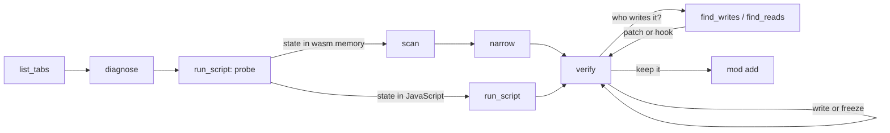

# Agent guide: changing any app over MCP

This is the playbook for an AI agent (or a person driving one) that changes a web app or browser game
running in the user's browser: a value in memory, a switch in the page's JavaScript, or a feature
added on top, kept as a mod that comes back on every load. [docs/TOOLS.md](TOOLS.md) is the full
tool reference and [docs/ARCHITECTURE.md](ARCHITECTURE.md) how it works; this file is the order of
operations, the decision table and the traps.

## 1. Setup

Build from source and load the extension as in [docs/QUICKSTART.md](QUICKSTART.md), then register
the MCP server with your client: the line for each one is in the README under
[Connect your agent](../README.md#connect-your-agent).

The server tells the agent how to work as soon as it connects: it sends this loop as its MCP
instructions, and `wasmcheat_guide({topic})` returns the
[mod-any-webapp skill](../.agents/skills/mod-any-webapp/SKILL.md) piece by piece. Topics: `workflow`
(start here), `routes`, `probe`, `il2cpp`, `mod-template`, `example-playcanvas`, `example-unity`.
`probe` and `il2cpp` return scripts to pass to `wasmcheat_run_script` as they are.

The extension dials the server on `ws://127.0.0.1:7331/extension` and reconnects on its own, so the
order you start them in does not matter. It pairs with the server on first connect and keeps the
token, so there is nothing to paste unless pairing is off (`WASMCHEAT_PAIRING=off`, or a server
started with `WASMCHEAT_TOKEN`).

The user has the same tools in DevTools → **WasmCheat**: every tool as a form, a raw console and a
live audit log, over the same dispatcher as the agent. It is the fastest way to check what the agent
sees.

## 2. What the agent may and may not do

There is no approval prompt to ask for. `tabId` is optional on every tool: omit it and the extension
acts on the front tab of the focused window, the page the user has open. Once `wasmcheat_list_tabs` has
shown you which tab is the game, pass its `tabId` on every call anyway: with more than one window open,
the tab in front can change while you work.

You still do not guess. `wasmcheat_list_tabs` tells you what is open; `attach` tells you what the
agent can see. If the page is a game, work there; if it is a bank, ask before touching anything, and
respect a no without retrying. Change only what the client owns: never a score reported to a
platform, never multiplayer state, and ask before writing a save that syncs.

Every change you make is recorded, whoever made it: a write, a freeze, a watch, a scan begin or
narrow, a hook, a patch, a watchpoint arm, a pointer scan, a bookmark, a speed change, a reload, a
script run (with its code), and a mod added or removed. Do not make changes you would not want to
explain in that log.

## 3. The loop



Pick the route first. A JavaScript engine (PlayCanvas, three.js, Phaser) or a web app keeps its
state in JavaScript objects: change them with `wasmcheat_run_script`. A YouTube Playable keeps it
in its save. A compiled game (Unity, Godot, Emscripten) keeps it in wasm memory: scan for it, or,
for Unity, read its classes by name (3.9). `wasmcheat_guide({topic: "routes"})` has the table per
engine.

### 3.1 Attach

```json
{ "tabId": 123 }
```

No `tabId` means the tab in front. `wasmcheat_list_tabs` returns `tabId`, `title`, `url`, `active`,
`agentAttached` and `frames` (so you can see a game inside an iframe). `attach` returns `pageAgent`
info including `evalAllowed`. If that is `false`, the page's content security policy (CSP, the
header that says what code a page may run) blocks `new Function`, so free-form hook bodies and
scripts fail and you must use declarative hook fallbacks. It is absent until the first hook with a
body, because on a page that enforces Trusted Types (a CSP mode that rejects strings turned into
code) checking earlier is itself a reported violation.

### 3.2 Diagnose an empty instance list

```json
{ "tabId": 123 }
```

`wasmcheat_diagnose` is the answer to "why is `list_instances` empty?". It reports what the page agent has
seen (`calls.instantiate`, `calls.instantiateStreaming`, `calls.newInstance`), the iframes with their
cross-origin flag, canvases, `.wasm` URLs found in the HTML, and a hint. The three usual causes:

| `diagnose` says | meaning | fix |
|---|---|---|
| `calls.* == 0`, no iframes | the extension was not in the page before the game booted | `attach` reloads the tab once on its own; if it still returns `NO_AGENT`, pass `"reload": true` |
| cross-origin iframe listed | the game lives in a subframe | the extension already routes into frames; if not, pass `frameId` from `list_tabs` |
| `instances: 0`, `wasmReferences` has URLs | the game is a worker or WebGL build | check `wasmcheat_list_workers` (nested workers appear as `k1n1`) |

No instances at all and no `.wasm` anywhere means the app is JavaScript: take the `run_script`
route.

### 3.3 List instances

`wasmcheat_list_instances` returns each instance with `id` (`w1`), `moduleHash`, memory size, exports and
`importPatchability`. `id: "latest"` resolves to the most recent instance at call time; use it when the
game re-instantiates and ids change under you. A freeze or watch created with `latest` pins the
instance it resolved to at that moment and keeps that id, so a newer instance cannot take it over; a
bookmark keeps `latest` as typed and resolves it each time you use it.

### 3.4 Scan

First pass, exact value:

```json
{ "tabId": 123, "instanceId": "w1", "type": "i32", "mode": "exact", "value": 75 }
```

Unknown value: omit `value` with `mode` defaulting to `changed`, do something in the game, then narrow.
A narrowing pass repeats the same tool with the `scanId` the previous pass returned (plus `tabId`, the
`instanceId` and the `type`, which the schema requires; only the `scanId` picks the scan, so pass the
same values as the first pass):

```json
{ "tabId": 123, "instanceId": "w1", "type": "i32", "scanId": "s1", "mode": "changed" }
```

Optional `from` / `to` limit the byte range, which is how you avoid scanning a multi-megabyte
zero-initialised heap.

Available modes: `exact`, `not-equal`, `less`, `greater`, `less-or-equal`, `greater-or-equal`, `between`
(with `value` + `value2`), `changed`, `unchanged`, `increased`, `decreased`, `increased-by`,
`decreased-by`. Types: `i8 u8 i16 u16 i32 u32 i64 u64 f32 f64`.

Text and byte search: `wasmcheat_scan_text` with `"encoding": "ascii" | "utf8" | "bytes"` (bytes wants
even-length hex like `"deadbeef"`).

**Save the list before anything reloads the page.** A scan lives in page memory and dies on reload, and
you will reload, because `find_writes`, `find_reads` and function patches all need it. Once a scan is
narrow enough to be useful, `wasmcheat_saved {action: "save", name: "score", scanId}` freezes it in the
tab's own `sessionStorage`; after the reload, `{action: "open", name: "score"}` returns a fresh `scanId`
(and the `instanceId` to use) that narrows like any other. Saving costs one call and saves you a scan;
do it before every reload you cause.

**Choose the right width before you choose the value.** Currencies, scores and timers in engine-built games
(Unity, Godot, Emscripten) are frequently `i64` or `f64`, and are frequently mirrored in two places. If an
`i32` exact scan returns nothing, try `i64` and `f64` with the same number before concluding the value is
not in linear memory.

A bookmark is the lightweight version of the same idea: `wasmcheat_bookmark {action: "add", label:
"score", address, type}` keeps one address under a name in the site's `localStorage`, so you can
read it later (`{action: "list"}`) without a scan or a saved session.

### 3.5 Verify, then act

`wasmcheat_read` before and after every write. Never trust the screen as evidence: games repaint the HUD
when *they* change a value, so a frozen value can be correct in memory while the display lags by a frame or
a second.

```json
{ "address": "w1:0x408", "type": "i32" }
{ "address": "w1:0x408", "type": "i32", "value": 123456 }
{ "action": "set", "address": "w1:0x408", "type": "i32", "value": 999999999 }
```

Freeze is a page-side interval that re-writes the value whenever it drifts. Freeze **all** mirror copies
you found, not just one. Then ask the user what they see.

### 3.6 Find the code (watchpoints)

`wasmcheat_find_writes` answers "which function writes this address?":

```json
{ "tabId": 123, "address": "w1:0x408", "type": "i64", "timeoutSeconds": 20 }
```

It arms a watchpoint, reloads the tab (a store cannot be hooked after compilation), re-attaches, and then
**waits on hit events**: it returns as soon as the game writes, naming `mine` or `wasm-function[12]` and
the old/new values. `wasmcheat_find_reads` is the same for loads.

Attribution comes from the rewritten module, so a function index is always correct; the *name* only exists
if the function is exported. Unnamed functions are still identifiable by index and by call counts
(`functions[]` in the status).

### 3.7 Patch or hook

```json
{ "action": "add", "instanceId": "w1", "target": "export", "name": "get_score", "body": "return ctx.call(args) + 1000000;" }
```

Script hooks are the reversible option, with no reload: `{action: "enable", hookId, enabled: false}`
switches one off, `enabled: true` back on, and `remove` restores the original behaviour. Import hooks
can only apply at the next instantiation. `hook` reports `pending: true` for a live instance, and this
is a WebAssembly fact, not a limitation of this tool.

Function patches (`wasmcheat_patch`) rewrite the body itself (`stub`, `empty`) and take effect when the
instrumented module is instantiated. They are the only way to change a function that nothing calls through
an export.

### 3.8 Keep it as a mod

`wasmcheat_mod {action: "add", name, code}` runs the code now, as `wasmcheat_run_script` does, and
keeps it only if it works. The extension stores it for the site of the game frame and runs it again on
every load. `list` shows the kept mods, `remove` stops one from running on the next load.

A mod runs as soon as its frame starts, before the engine exists. Every script gets two helpers:

- `until(check, timeoutMs = 30000, everyMs = 100)` waits until `check()` is truthy (it may be async)
  and returns its value: `const app = await until(() => window.pc?.app);`.
- `wasm(id = 'latest')` returns a captured instance as `{id, memory, exports}`.

`wasmcheat_guide({topic: "mod-template"})` is a starting point with an on-screen menu.

### 3.9 A mod that finds its values by name

A value found by scanning sits at an address the next load moves, so a mod has to find it again by
itself, and a name survives reloads where an address does not:

- **A YouTube Playable saves through `ytgame.game.loadData()`**, whatever the engine. Read it first with
  `wasmcheat_run_script`: the save usually names every value the game keeps (`kCoins`, `kTokens`,
  `G_Current_Level` in Stealth Master), so you know what to look for and its value now.
- **Unity keeps those values in a `Dictionary<string, int>`.** A Unity web build is compiled by
  IL2CPP, Unity's compiler from C# to C++ (and from there to wasm), so its C# objects sit in wasm
  memory with a known layout. An entry is `{hash, next, key, value}` and the key is a string object
  `{klass, monitor, length, UTF-16 chars}`. Find the string with `wasmcheat_scan_text` (`bytes`: the
  length as a little-endian i32, then the UTF-16 text), then the words that hold its address (a `u32`
  scan for it). The entry is the one whose `next`, the word before, is a small index (-1 when last).
  Its value is the word after. `wasmcheat_guide({topic: "il2cpp"})` reads classes and fields by name.
- **In a mod, do the same search on every load** with `new Uint32Array(wasm().memory.buffer)`, taken
  again on every use because the memory grows.

A value that only lives while a level runs (a mission's coin counter) is a copy: the real one is
written back at the end of the level. Write the saved one.

## 4. Symptom → tool

| Symptom | Tool |
|---|---|
| Which tabs can I touch? | `wasmcheat_list_tabs` |
| Nothing to attach to | `wasmcheat_diagnose` |
| What is this page built with? | `wasmcheat_run_script` with the `probe` script from `wasmcheat_guide` |
| Where is the score? | `wasmcheat_scan` (then `scan_results`) |
| Value is text | `wasmcheat_scan_text` |
| Who changes this number? | `wasmcheat_find_writes` |
| Who reads this number? | `wasmcheat_find_reads` |
| This address moves every level | `wasmcheat_pointer_scan` + `wasmcheat_pointer_resolve` |
| I want the game to lie about a value | `wasmcheat_hook` |
| The function is not exported | `wasmcheat_patch` |
| It lives in the game's JavaScript, not in wasm (PlayCanvas, three.js, a Unity instance) | `wasmcheat_run_script` |
| The change should come back after every reload | `wasmcheat_mod` with `add`; start with `await until(() => window.pc?.app)`, or find a memory value by name (3.9) |
| The game runs too slowly to line up a scan | `wasmcheat_speed` (`scale: 0` freezes the clock) |
| What did I just do? | `wasmcheat_audit` |

## 5. Traps

- **Freeze then test by read.** The HUD may not move even when memory did.
- **A reload invalidates ids.** Use `instanceId: "latest"`; scan sessions do not survive a reload.
- **`evalAllowed: false`** means CSP blocks script bodies: use declarative hook fallbacks
  (`replace-return`, `offset-result`), not `new Function` bodies.
- **A kept script runs before the game exists.** Wait for the engine with `until(check)` and guard
  against a second run with a flag on `window`; a script that throws is not kept.
- **Never arm a watchpoint twice.** Re-arming the same address is idempotent, but switching addresses
  clears hits.
- **Do not poll for attach or watchpoint hits.** `attach` and `find_writes` / `find_reads` wait on
  events and return when they arrive; a poll loop around them only adds latency and audit noise. A
  watch is different: its changes are collected only when you call `wasmcheat_watch` with `poll`.
- **Popup open, session alive.** The toolbar popup keeps the service worker awake; with it closed, the
  extension reconnects on its alarm and a call in that window returns `NO_AGENT`, which is retryable.
