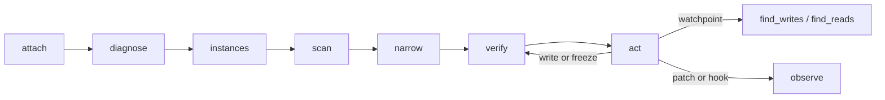

# Agent guide: hacking a wasm game over MCP

This is the playbook for an AI agent (or a human driving one) that wants to find and change a value in a
WebAssembly game running in the user's browser. Read `README.md` for architecture and the full tool
reference; this file is the order of operations, the decision table, and the traps.

## 1. One-time setup

```bash
npm install && npm run build      # builds protocol, wasm-instrument, page agent, extension, MCP server
```

1. `chrome://extensions` → Developer mode → **Load unpacked** → `packages/extension/dist`.
2. Point your MCP client at the server (stdio, no arguments needed):

```json
{
  "mcpServers": {
    "wasmcheat": { "command": "node", "args": ["/absolute/path/to/wasm-ce/packages/mcp-server/dist/bin.js"] }
  }
}
```

The extension dials the server on `ws://127.0.0.1:7331/extension`, so start the MCP client *after* the
extension is loaded (or wait a second — it reconnects on its own).

## 2. What the agent may and may not do

Every tab needs a human grant before any memory read. That grant is per tab and per site, it survives
navigation inside the site, and it is revoked when the tab leaves the site or closes. There is no way
around it from the agent side, and the agent should not pretend otherwise: if a call returns
`NEED_APPROVAL`, ask the human to click **Approve** in the toolbar popup.

Approval is **event-based**: `wasmcheat_attach` blocks on a decision event rather than re-reading state on
a timer, so the moment the human clicks, the call returns. Do not poll `wasmcheat_approval_status` in a
loop; call `attach` once and let it wait.

## 3. The loop



### 3.1 Attach

```json
{ "tabId": 1310636703, "reason": "find the coin counter" }
```

`wasmcheat_list_tabs` first: it returns `tabId`, `title`, `url`, `approval`, `agentAttached`, and `frames`
(so you can see a game inside an iframe). `attach` returns `pageAgent` info including `evalAllowed` — if
that is `false` the page's CSP blocks `new Function`, so free-form hook bodies will fail and you must use
declarative hook fallbacks.

### 3.2 Diagnose an empty instance list

```json
{ "tabId": 1310636703 }
```

`wasmcheat_diagnose` is the answer to "why is `list_instances` empty?". It reports what the page agent has
seen (`calls.instantiate`, `calls.instantiateStreaming`, `calls.newInstance`), the iframes with their
cross-origin flag, canvases, `.wasm` URLs found in the HTML, and a hint. The three usual causes:

| `diagnose` says | meaning | fix |
|---|---|---|
| `calls.* == 0`, no iframes | the extension was not in the page before the game booted | `attach` with `"reload": true` |
| cross-origin iframe listed | the game lives in a subframe | the extension already routes into frames; if not, pass `frameId` from `list_tabs` |
| `instances: 0`, `wasmReferences` has URLs | the game is a worker or WebGL build | check `wasmcheat_list_workers` |

### 3.3 List instances

`wasmcheat_list_instances` returns each instance with `id` (`w1`), `moduleHash`, memory size, exports and
`importPatchability`. `id: "latest"` resolves to the most recent instance at call time — use it when the
game re-instantiates and ids change under you.

### 3.4 Scan

First pass, exact value:

```json
{ "tabId": 1310636703, "instanceId": "w1", "type": "i32", "mode": "exact", "value": 75 }
```

Unknown value: omit `value` with `mode` defaulting to `changed`, do something in the game, then narrow.
Narrowing passes (`value` = the scan id from the previous pass):

```json
{ "address": "s1", "mode": "changed" }
```

Available modes: `exact`, `not-equal`, `less`, `greater`, `less-or-equal`, `greater-or-equal`, `between`
(with `value` + `value2`), `changed`, `unchanged`, `increased`, `decreased`, `increased-by`,
`decreased-by`. Types: `i8 u8 i16 u16 i32 u32 i64 u64 f32 f64`.

Text and byte search: `wasmcheat_scan_text` with `"encoding": "ascii" | "utf8" | "bytes"` (bytes wants
even-length hex like `"deadbeef"`).

**Choose the right width before you choose the value.** Currencies, scores and timers in engine-built games
(Unity, Godot, Emscripten) are frequently `i64` or `f64`, and are frequently mirrored in two places. If an
`i32` exact scan returns nothing, try `i64` and `f64` with the same number before concluding the value is
not in linear memory.

### 3.5 Verify, then act

`wasmcheat_read` before and after every write. Never trust the screen as evidence: games repaint the HUD
when *they* change a value, so a frozen value can be correct in memory while the display lags by a frame or
a second.

```json
{ "address": "w1:0x408", "type": "i32" }
{ "address": "w1:0x408", "type": "i32", "value": 123456 }
{ "action": "set", "address": "w1:0x408", "type": "i32", "value": 999999999 }
```

Freeze is a page-side interval that re-writes the value whenever it drifts. Freeze **all** mirror copies
you found, not just one.

### 3.6 Find the code (watchpoints)

`wasmcheat_find_writes` answers "which function writes this address?":

```json
{ "tabId": 1310636703, "address": "w1:0x408", "type": "i64", "timeoutSeconds": 20 }
```

It arms a watchpoint, reloads the tab (a store cannot be hooked after compilation), re-attaches, and then
**waits on hit events** — it returns as soon as the game writes, naming `mine` or `wasm-function[12]` and
the old/new values. `wasmcheat_find_reads` is the same for loads.

Attribution comes from the rewritten module, so a function index is always correct; the *name* only exists
if the function is exported. Unnamed functions are still identifiable by index and by call counts
(`functions[]` in the status).

### 3.7 Patch or hook

```json
{ "action": "add", "instanceId": "w1", "target": "export", "name": "get_score", "body": "return ctx.call(args) + 1000000;" }
```

Script hooks are the reversible option: `disable` and `remove` restore the original behaviour with no
reload. Import hooks can only apply at the next instantiation — `hook` reports `pending: true` for a live
instance, and this is a WebAssembly fact, not a limitation of this tool.

Function patches (`wasmcheat_patch`) rewrite the body itself (`stub`, `empty`) and take effect when the
instrumented module is instantiated. They are the only way to change a function that nothing calls through
an export.

## 4. Symptom → tool

| Symptom | Tool |
|---|---|
| Which tabs can I touch? | `wasmcheat_list_tabs` |
| Nothing to attach to | `wasmcheat_diagnose` |
| Where is the score? | `wasmcheat_scan` (then `scan_results`) |
| Value is text | `wasmcheat_scan_text` |
| Who changes this number? | `wasmcheat_find_writes` |
| Who reads this number? | `wasmcheat_find_reads` |
| This address moves every level | `wasmcheat_pointer_scan` + `wasmcheat_pointer_resolve` |
| I want the game to lie about a value | `wasmcheat_hook` |
| The function is not exported | `wasmcheat_patch` |
| What did I just do? | `wasmcheat_audit` |

## 5. Traps

- **Freeze then test by read.** The HUD may not move even when memory did.
- **`i32` is a guess.** Try `i64`/`f64` on a miss, and remember the value may be mirrored.
- **A reload invalidates ids.** Use `instanceId: "latest"`; scan sessions do not survive a reload.
- **`evalAllowed: false`** means CSP blocks script bodies: use declarative hook fallbacks
  (`replace-return`, `offset-result`), not `new Function` bodies.
- **Never arm a watchpoint twice.** Re-arming the same address is idempotent, but switching addresses
  clears hits.
- **Do not poll.** Attach, watchpoints and approvals are event-driven; a poll loop only adds latency and
  noise to the audit log.
- **Popup open, session alive.** The toolbar popup keeps the service worker awake; with it closed, the
  extension reconnects on its alarm and a call in that window returns `NO_AGENT`, which is retryable.
