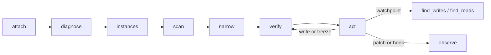

# Agent guide: hacking a wasm game over MCP

This is the playbook for an AI agent (or a human driving one) that wants to find and change a value in a
WebAssembly game running in the user's browser. Read `README.md` for architecture and the full tool
reference; this file is the order of operations, the decision table, and the traps.

## 1. One-time setup

```bash
npm install && npm run build      # builds protocol, wasm-instrument, page agent, extension, MCP server
```

1. `chrome://extensions` → Developer mode → **Load unpacked** → `packages/extension/dist`.
2. Point your MCP client at the server (stdio, no arguments needed):

```json
{
  "mcpServers": {
    "wasmcheat": { "command": "node", "args": ["/absolute/path/to/wasm-ce/packages/mcp-server/dist/bin.js"] }
  }
}
```

The extension dials the server on `ws://127.0.0.1:7331/extension`, so start the MCP client *after* the
extension is loaded (or wait a second: it reconnects on its own).

The bridge is authenticated, and the token stays out of your way: the extension pairs with the server
on first connect and stores what it gets. You only touch the field when pairing is off
(`WASMCHEAT_PAIRING=off`, or a server started with `WASMCHEAT_TOKEN`).

The human also has a front-end: DevTools → **WasmCheat** exposes every tool as a form, plus a raw RPC
console and a live event and audit log. It talks to the same dispatcher as the agent, so the two never
drift. It is the fastest way to check what the agent sees.

## 2. What the agent may and may not do

There is no approval prompt to ask for. `tabId` is optional on every tool: omit it and the extension
acts on the tab in front, the page the human has open. Ask only when the human names a second tab.

You still do not guess. `wasmcheat_list_tabs` tells you what is open; `attach` tells you what the
agent can see. If the human's page is a game, work there; if it is a bank, ask before touching
anything, and respect a `no` without retrying.

Every mutation you make is recorded, whoever made it: a write, a freeze, a watch, a scan begin or
narrow, a hook, a patch, a watchpoint arm, a pointer scan, a bookmark, a speed change, a reload. Do
not make changes you would not want to explain in that log.

## 3. The loop



### 3.1 Attach

```json
{ "reason": "find the coin counter" }
```

No `tabId` means the tab in front. `wasmcheat_list_tabs` returns `tabId`, `title`, `url`, `active`,
`agentAttached` and `frames`
(so you can see a game inside an iframe). `attach` returns `pageAgent` info including `evalAllowed`. If
that is `false` the page's CSP blocks `new Function`, so free-form hook bodies will fail and you must use
declarative hook fallbacks. It is absent until the first hook with a body: checking earlier is itself a
violation on a page that enforces Trusted Types.

### 3.2 Diagnose an empty instance list

```json
{ "tabId": 1310636703 }
```

`wasmcheat_diagnose` is the answer to "why is `list_instances` empty?". It reports what the page agent has
seen (`calls.instantiate`, `calls.instantiateStreaming`, `calls.newInstance`), the iframes with their
cross-origin flag, canvases, `.wasm` URLs found in the HTML, and a hint. The three usual causes:

| `diagnose` says | meaning | fix |
|---|---|---|
| `calls.* == 0`, no iframes | the extension was not in the page before the game booted | `attach` reloads the tab once on its own; if it still says `no relay`, pass `"reload": true` |
| cross-origin iframe listed | the game lives in a subframe | the extension already routes into frames; if not, pass `frameId` from `list_tabs` |
| `instances: 0`, `wasmReferences` has URLs | the game is a worker or WebGL build | check `wasmcheat_list_workers` (nested workers appear as `k1n1`) |

### 3.3 List instances

`wasmcheat_list_instances` returns each instance with `id` (`w1`), `moduleHash`, memory size, exports and
`importPatchability`. `id: "latest"` resolves to the most recent instance at call time; use it when the
game re-instantiates and ids change under you. A freeze or watch created with `latest` pins the
instance it resolved to at that moment and keeps that id, so a newer instance cannot take it over; a
bookmark keeps `latest` as typed and resolves it each time you use it.

### 3.4 Scan

First pass, exact value:

```json
{ "tabId": 1310636703, "instanceId": "w1", "type": "i32", "mode": "exact", "value": 75 }
```

Unknown value: omit `value` with `mode` defaulting to `changed`, do something in the game, then narrow.
A narrowing pass repeats the same tool with the `scanId` the previous pass returned (plus `tabId`, the
`instanceId` and the `type`; the server validates all four):

```json
{ "tabId": 1310636703, "instanceId": "w1", "type": "i32", "scanId": "s1", "mode": "changed" }
```

Optional `from` / `to` limit the byte range, which is how you avoid scanning a multi-megabyte
zero-initialised heap.

Available modes: `exact`, `not-equal`, `less`, `greater`, `less-or-equal`, `greater-or-equal`, `between`
(with `value` + `value2`), `changed`, `unchanged`, `increased`, `decreased`, `increased-by`,
`decreased-by`. Types: `i8 u8 i16 u16 i32 u32 i64 u64 f32 f64`.

Text and byte search: `wasmcheat_scan_text` with `"encoding": "ascii" | "utf8" | "bytes"` (bytes wants
even-length hex like `"deadbeef"`).

**Save the list before anything reloads the page.** A scan lives in page memory and dies on reload, and
you will reload, because `find_writes`, `find_reads` and function patches all need it. Once a scan is
narrow enough to be useful, `wasmcheat_saved {action: "save", name: "score", scanId}` freezes it in the
tab's own `sessionStorage`; after the reload, `{action: "open", name: "score"}` returns a fresh `scanId`
(and the `instanceId` to use) that narrows like any other. Saving costs one call and saves you a scan;
do it before every reload you cause.

**Choose the right width before you choose the value.** Currencies, scores and timers in engine-built games
(Unity, Godot, Emscripten) are frequently `i64` or `f64`, and are frequently mirrored in two places. If an
`i32` exact scan returns nothing, try `i64` and `f64` with the same number before concluding the value is
not in linear memory.

A bookmark is the lightweight version of the same idea: `wasmcheat_bookmark {action: "add", label:
"score", address, type}` keeps one address under a name in the site's `localStorage`, so you can
read it later (`{action: "list"}`) without a scan or a saved session.

### 3.5 Verify, then act

`wasmcheat_read` before and after every write. Never trust the screen as evidence: games repaint the HUD
when *they* change a value, so a frozen value can be correct in memory while the display lags by a frame or
a second.

```json
{ "address": "w1:0x408", "type": "i32" }
{ "address": "w1:0x408", "type": "i32", "value": 123456 }
{ "action": "set", "address": "w1:0x408", "type": "i32", "value": 999999999 }
```

Freeze is a page-side interval that re-writes the value whenever it drifts. Freeze **all** mirror copies
you found, not just one.

### 3.6 Find the code (watchpoints)

`wasmcheat_find_writes` answers "which function writes this address?":

```json
{ "tabId": 1310636703, "address": "w1:0x408", "type": "i64", "timeoutSeconds": 20 }
```

It arms a watchpoint, reloads the tab (a store cannot be hooked after compilation), re-attaches, and then
**waits on hit events**: it returns as soon as the game writes, naming `mine` or `wasm-function[12]` and
the old/new values. `wasmcheat_find_reads` is the same for loads.

Attribution comes from the rewritten module, so a function index is always correct; the *name* only exists
if the function is exported. Unnamed functions are still identifiable by index and by call counts
(`functions[]` in the status).

### 3.7 Patch or hook

```json
{ "action": "add", "instanceId": "w1", "target": "export", "name": "get_score", "body": "return ctx.call(args) + 1000000;" }
```

Script hooks are the reversible option: `disable` and `remove` restore the original behaviour with no
reload. Import hooks can only apply at the next instantiation. `hook` reports `pending: true` for a live
instance, and this is a WebAssembly fact, not a limitation of this tool.

Function patches (`wasmcheat_patch`) rewrite the body itself (`stub`, `empty`) and take effect when the
instrumented module is instantiated. They are the only way to change a function that nothing calls through
an export.

## 4. Symptom → tool

| Symptom | Tool |
|---|---|
| Which tabs can I touch? | `wasmcheat_list_tabs` |
| Nothing to attach to | `wasmcheat_diagnose` |
| Where is the score? | `wasmcheat_scan` (then `scan_results`) |
| Value is text | `wasmcheat_scan_text` |
| Who changes this number? | `wasmcheat_find_writes` |
| Who reads this number? | `wasmcheat_find_reads` |
| This address moves every level | `wasmcheat_pointer_scan` + `wasmcheat_pointer_resolve` |
| I want the game to lie about a value | `wasmcheat_hook` |
| The function is not exported | `wasmcheat_patch` |
| It lives in the game's JavaScript, not in wasm (PlayCanvas, three.js, a Unity instance) | `wasmcheat_run_script` |
| The change should come back after every reload | `wasmcheat_mod` with `add`; start with `await until(() => window.pc?.app)` |
| The game runs too slowly to line up a scan | `wasmcheat_speed` (`scale: 0` freezes the clock) |
| What did I just do? | `wasmcheat_audit` |

## 5. Traps

- **Freeze then test by read.** The HUD may not move even when memory did.
- **`i32` is a guess.** Try `i64`/`f64` on a miss, and remember the value may be mirrored.
- **A reload invalidates ids.** Use `instanceId: "latest"`; scan sessions do not survive a reload.
- **`evalAllowed: false`** means CSP blocks script bodies: use declarative hook fallbacks
  (`replace-return`, `offset-result`), not `new Function` bodies.
- **A kept script runs before the game exists.** Wait for the engine with `until(check)` and guard
  against a second run with a flag on `window`; a script that throws is not kept.
- **Never arm a watchpoint twice.** Re-arming the same address is idempotent, but switching addresses
  clears hits.
- **Do not poll.** Attach and watchpoints are event-driven; a poll loop only adds latency and
  noise to the audit log.
- **Popup open, session alive.** The toolbar popup keeps the service worker awake; with it closed, the
  extension reconnects on its alarm and a call in that window returns `NO_AGENT`, which is retryable.
