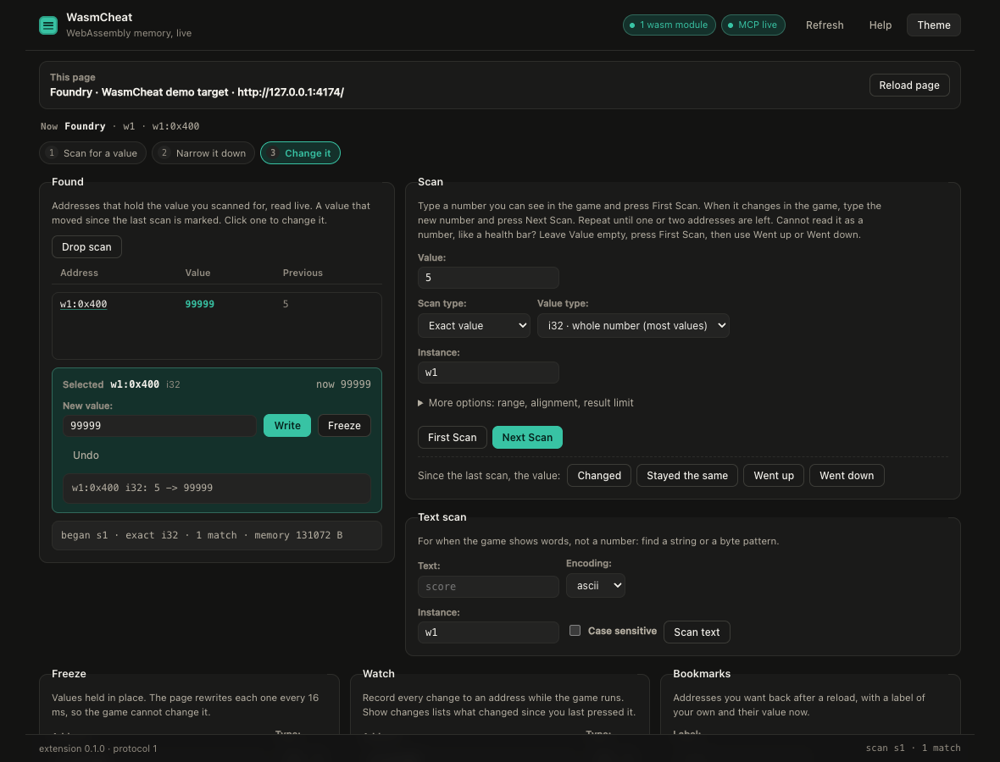
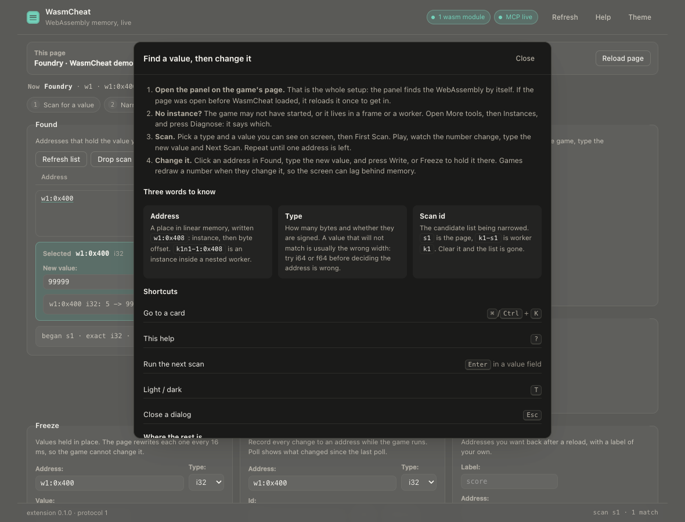
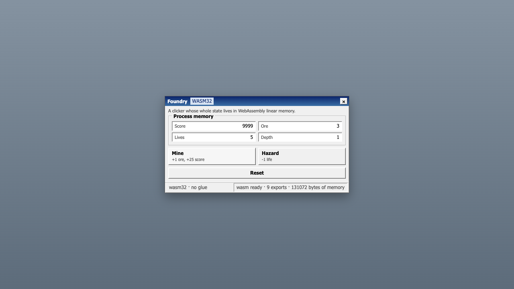

# Architecture

How WasmCheat is put together and why. For using it, start with the [README](../README.md).

Two terms come up throughout. The **MAIN world** is the page's own JavaScript, where its objects live;
an extension's content scripts normally run in an **isolated world** beside it that shares the DOM but
not the objects. A **realm** is one such JavaScript world: a page, an iframe or a worker each has its own.

## Packages

| Package | Role |
| --- | --- |
| `packages/protocol` | The single shared contract: message envelopes, address format, value types, error codes, scan/hook/watch shapes. |
| `packages/page-agent` | Runs in the page's **MAIN world** and in every Web Worker. Patches `WebAssembly.instantiate*` / `new WebAssembly.Instance` to capture instances, then does the real work: memory access, scanning, freezing, watches, hooks, watchpoint instrumentation. |
| `packages/extension` | MV3 extension. Injects the page agent at `document_start`, relays RPC from the service worker, owns the WebSocket to the MCP server, and ships the DevTools panel and popup. |
| `packages/mcp-server` | Node 22 stdio MCP server. Exposes the `wasmcheat_*` tools, talks to the extension over a local WebSocket, writes the audit log. |
| `packages/wasm-instrument` | Rewrites a wasm binary before it is compiled: the watchpoint probes on loads and stores, and the function patches. |
| `packages/demo-app` | A tiny C game compiled to a standalone wasm module, plus a hand-written loader. The test target. |


## How the pieces talk

```
┌─────────────────────────── Chrome tab (the target) ───────────────────────────┐
│  page scripts                     MAIN world                                  │
│  ───────────                      ──────────                                  │
│  app ↔ WebAssembly.Memory  ←──  page-agent: captured instances,               │
│                                     scan / read / write / freeze / watch /    │
│                                     export+import hooks                       │
│                                        ▲  postMessage (window)                │
│  isolated world                        │                                      │
│  relay.js  ────────────────────────────┘  channel handshake, RPC per id       │
└───────────────────────────────────────┬───────────────────────────────────────┘
                                        │ chrome.runtime.sendMessage
┌───────────────────────────────────────▼───────────────────────────────────────┐
│  extension service worker (sw.js)                                             │
│  · injects relay + page-agent on demand, one realm per frame and worker       │
│  · routes page.* RPC to the frame that holds the wasm                        │
└───────────────────────────────────────┬───────────────────────────────────────┘
                                        │ ws://127.0.0.1:7331/extension
┌───────────────────────────────────────▼───────────────────────────────────────┐
│  mcp-server (Node 22, stdio)                                                  │
│  · wasmcheat_* tools  · zod validation  · audit.jsonl                         │
└───────────────────────────────────────┬───────────────────────────────────────┘
                                        │ MCP (stdio)
                                    your agent
```

Why it looks like this:

- **The page agent has to run in the MAIN world.** `WebAssembly.Instance` objects only exist in
  the realm that created them; an isolated-world script sees nothing. The cost is that page
  scripts can also see the `postMessage` channel. The first `channelId` handshake of a document
  wins and results without that id are dropped, which stops cross-talk and blind spoofing, not a
  page that reads the traffic. The real trust boundary is the extension itself, which lives
  outside the page.
- **The agent is injected at `document_start`, before the app instantiates.** There is no API to
  enumerate pre-existing `WebAssembly.Instance` objects, so capture only works if the patch is in
  place first. If you attach to an already-loaded page, pass `reload: true` and the tab reloads
  with the agent already installed (the reload is audited).
- **The extension dials the server, not the other way round.** Only the extension can reach tab
  contents, so the MCP server is the listener and the extension is the client. A new
  connection takes over only after it proves the token; the old socket is then closed and its
  pending calls fail at once with `NO_AGENT`.
- **Scanning runs inside the page.** Snapshot passes loop over typed arrays in the page and only
  addresses plus a small sample travel back over the bridge, so a 16 MB heap scan is not a
  16 MB JSON round-trip.
- **Memory reads re-read `memory.buffer` on every call**, because `memory.grow` detaches the old
  buffer.

### Subframes

Games rarely live in the document you are looking at: a YouTube Playable, an itch.io embed or a
Unity wrapper runs in a **cross-origin iframe**, where a content script injected into the top
document cannot see it. Both content scripts are therefore registered with `all_frames: true`,
each frame's relay announces itself with its `frameId` and URL, and the service worker picks the
frame that actually captured a wasm instance (probing each one with `page.diagnose` when it has
to). A pick that held no wasm is only a guess and is asked again every two seconds, because the
game frame usually instantiates after the page (and the panel) opened. `wasmcheat_list_tabs` shows the frames; `wasmcheat_attach` accepts `frameId` to override the
choice. A call always goes to exactly one frame (the top frame when none is known yet), never to
every frame at once.

### Web Workers

Unity, Godot 4 and most itch.io builds instantiate their module **inside a Web Worker**, where the
page realm's `WebAssembly` hook can never see it. The page agent therefore replaces `Worker` itself
and boots a second copy of itself inside each worker (prepending `importScripts('<extension>/worker-agent.js')`
to a small blob wrapper), so worker instances are captured by the same registry, scan store and
hook store as page instances. `wasmcheat_list_workers` reports them, and their instance ids are
namespaced by the worker that owns them (`k1-1`).

The wrapper is installed **at `document_start`**, before the page's own scripts, because a worker
created earlier than the wrapper is invisible forever, and game loaders create their worker in their
first script, which is exactly the losing side of that race. The agent cannot build an extension
URL on its own, so the isolated-world relay publishes it on `document.documentElement`
(`data-wasmcheat-agent`) synchronously, and the wrapper resolves it per construction; if the
attribute is ever missing the page gets a plain, uninstrumented worker rather than a broken one.

A worker that starts a worker is captured the same way: each worker agent installs that wrapper too,
so the grandchild's ids chain the names (`k1n1-1` belongs to the worker `k1` started), and a call for
one is routed down the chain rather than refused. The e2e suite covers a page → worker → worker
chain in `nested.html`.

### The DevTools panel

Open DevTools → **WasmCheat**. The panel is a second front end on the same dispatcher the WebSocket
uses (`wasmcheat.panel.call` → `handleBridgeRequest`), so it cannot skip
the audit log. The service worker answers that message only from the extension's own pages.

It follows the order you work in: the page, the scan, the hits, what you can do to one address, then
the advanced tooling and the raw console. The header keeps two facts on screen (how many wasm modules
the page runs, and whether an MCP server is connected), and the `Now` line reads tab → instance →
address, so a write is never aimed at something you have forgotten about.

- The first screen is the loop (tab, scan, hits, one address). Clicking a hit opens an editor under
  the list with **Write** and **Freeze**, and the scan card hides the fields the chosen mode does not
  use. A steps strip marks where you are, and <kbd>Enter</kbd> in a
  value field runs whichever scan is next.
- Every tool is a form: freeze, watch, bookmarks, a hex **memory viewer** (16 bytes per row,
  Earlier/Later, **Follow pointer**, and any address you click jumps the dump to it), and under
  **More tools** the rest: workers, pointer scan and resolve, speed hack, saved lists, watchpoints,
  patches, hooks, the live audit view and a raw RPC console.
- <kbd>⌘</kbd>/<kbd>Ctrl</kbd> + <kbd>K</kbd> opens a palette over every card, filtered as you type.
  `?` opens the built-in help, `T` switches light and dark.
- Empty lists name the cause and the next action instead of saying "no data", and a refused call shows
  the error code next to the sentence that fixes it.





The demo target is a game window rather than a copy of the tool, so the two are never confused:



### Three WebAssembly facts that shape the tool

- **Imports are bound at instantiation.** A running instance can never gain a replaced import.
  Import hooks are therefore queued as rules that our patched `WebAssembly.instantiate` applies
  to the imports object *before* the engine sees it, and the created hook reports
  `pending: true` for the live instance. `importPatchability` in `wasmcheat_list_instances` says
  `next-instantiation` or `none`, never a fake `live`.
- **An export patch only reaches callers that read the property per call.** Replacing
  `instance.exports.get_score` works if the app calls `instance.exports.get_score()`. Emscripten's
  glue caches the function on first call (`_get_score = wasmExports['get_score']`), so patched
  exports are invisible to it. That is exactly why the demo ships a hand-written loader.
- **A store reports nothing.** No engine hook exists for "this instruction wrote this byte", so
  a watchpoint cannot be attached to a compiled module at all. `wasmcheat_find_writes` and
  `wasmcheat_find_reads` therefore rewrite the binary before it compiles: every store gains a
  gated call back into the page agent, and every load gains a gated identity call that reports
  the address it is about to touch. See [Watchpoints](TOOLS.md#watchpoints-asking-who-touched-this-address).

## The bridge, and why there is no token to paste

The MCP server listens on a local WebSocket and the extension dials it. That socket needs to know
which extension is real, so it is authenticated with a token the server mints into
`$WASMCHEAT_HOME/token` on first run.

You never see it. On the first connection the extension asks the server for the token over that same
socket (pairing) and stores it. From then on the token itself never crosses the socket; each side
proves it holds it:

1. the server opens with `bridge.challenge` and a random nonce;
2. the extension answers `bridge.hello` with a nonce of its own and an HMAC-SHA256 of both nonces,
   keyed with the token. A wrong proof is refused with `1008 bad bridge token`;
3. the server answers `bridge.welcome` with its own HMAC of the same nonces, under a different label.

What keeps that socket honest:

- The extension runs no request and sends nothing (no page events, no audit lines) until the
  welcome checks out, and hangs up when it does not. A program that grabs the port while the MCP
  server is down learns neither the token nor anything about your tabs.
- Pairing is answered only while no authenticated extension is connected, so a second client cannot
  ask for the token while the real extension holds the bridge.
- A connection only replaces the current one after its proof checks out, and each challenge is good
  for one hello.
- Until a socket proves the token, everything it sends except `bridge.hello` and `bridge.pair` is
  dropped: it cannot answer a request, raise an event or write an audit line.
- An upgrade whose `Origin` is a web page (anything but `chrome-extension://`) is refused, so a site
  open in the browser cannot dial the port.

Two limits. Pairing is trust on first use: an extension with no token believes whoever answers
`bridge.pair`, so a program on the port at that moment could hand it a token of its own (pin one with
`WASMCHEAT_TOKEN` to rule that out). And the handshake authenticates the socket, not each message, so
it does not stop a relay that sits between the extension and a real server on another port.

One case needs the field anyway, and it is in both the panel and the popup: **pairing is off**, because
the server was started with `WASMCHEAT_PAIRING=off` or with `WASMCHEAT_TOKEN` set. Then paste
`cat ~/.wasmcheat/token`. Pinning a token is the way to make the loopback socket useless to anything
else on the machine.

The panel pill says `MCP live` when the server is connected, `MCP token refused` when the server
rejected the stored token or the program on the port could not prove it holds it, and `MCP off` when
no server is running. `MCP off` is neutral: the panel works without the server, and the extension
checks the port with a silent request before dialing, so a stopped server leaves no errors in the
extensions page or the console.

## Nothing to approve, and everything logged

There is no approval prompt. Opening the panel on a tab is the decision: you are looking at that
page, in DevTools, on purpose. Everything follows from that:

- **The panel drives the tab it lives on.** Opened from DevTools it is the inspected tab; opened
  as a plain page it takes the tab in front. There is no tab picker, and the toolbar popup is only
  a status card.
- **Tools default to the tab in front.** `tabId` is optional on every MCP tool: an agent that does
  not pass one gets the tab you are looking at in the focused window. The server's instructions still
  tell an agent to pass the id from `wasmcheat_list_tabs`, because with several windows open the tab
  in front can change mid-task.
- **Nothing to attach in the panel, and the MCP attach heals itself.** The panel starts the agent
  on the tab it is opened on. For an agent, `wasmcheat_attach` injects it if the page has none; if
  the app started before the agent existed, it reloads the tab once, says so in its note, and keeps
  going.
- **The audit log is the record.** Every mutation is reported by the extension from a single
  funnel (`callTab`), so a human clicking Freeze and an agent calling `wasmcheat_freeze` produce the
  same line: tab, address, and `before -> after` for writes. Writes, freeze set/clear, watch
  add/remove, scan begin/narrow/drop, text scan, hook add/enable/remove, patch add/remove/clear,
  watchpoint arm/stop/clear, pointer scan, bookmark add/remove/clear, speed changes, reloads, script
  runs (with their code) and mod add/remove.
  Saved scan lists and attach/detach are recorded by the MCP server, because they are not page
  calls. Reads, `scan_results`, `pointer_resolve`, listing calls and watch polls are not logged:
  they change nothing and would bury the writes.
- **Lines land in `$WASMCHEAT_HOME/audit.jsonl`** (append-only, timestamped) and can be read back
  with `wasmcheat_audit`.

The page agent still runs in the MAIN world, so a hostile page can see its channel. The trust
boundary is the browser extension itself plus `127.0.0.1`-only bridging, not secrecy from the page.

## Limits

- Chromium browsers only (Manifest V3: Chrome, Brave, Edge). Firefox and Safari have no equivalent way
  to inject the page agent into the MAIN world at `document_start`.
- No way to enumerate wasm instances created before the agent was injected; use `reload: true`.
- Import hooks need a (re)instantiation; exports of glue-cached apps (Emscripten default) cannot
  be patched from JS at all, and the tool says so rather than pretending.
- The page-agent runs in the MAIN world, so a hostile page can talk to (or lie to) the relay. The
  extension protects you from a stray tool call; it is not a sandbox for the site you loaded.
- Strict-CSP pages block hook bodies; declarative fallbacks still work.
- The speed hack overrides `performance.now`, `Date.now` and `requestAnimationFrame` in the page realm
  and forwards the scale to every worker realm, so worker games speed up too. A game that derives
  time from `performance.timeOrigin`, or captured `Date.now` before the agent installed, keeps the
  real clock.
- The panel's memory viewer is read-only: it dumps, pans, follows a pointer and jumps to any address
  you click, but byte edits go through the typed write form (audited, returns `before -> after`).
- Pages that need cross-origin isolation for `SharedArrayBuffer` threads are not exercised; single
  realm atomics are probed. [STATUS.md](STATUS.md) keeps the current list.
