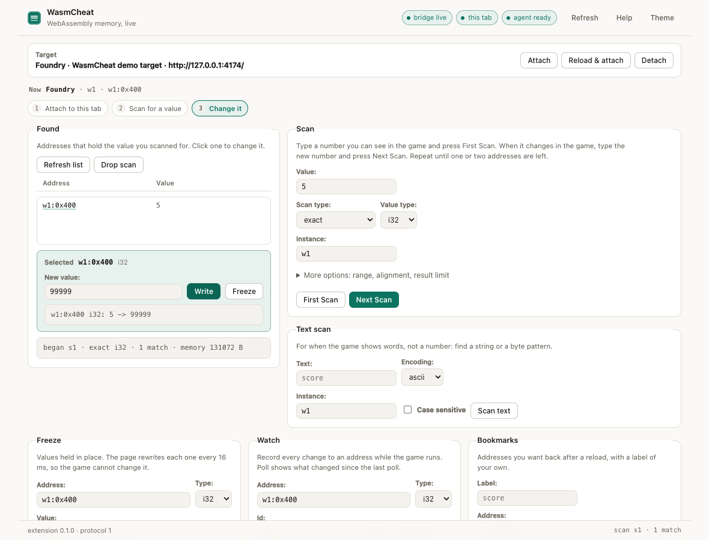

# The DevTools panel

The panel is the same bridge an MCP client talks to, with a human at the keyboard. Every call it
makes goes through the service worker's `wasmcheat.panel.call` family, which reuses the WebSocket
dispatcher, so frame routing, worker routing and the audit log behave identically. A panel is a
front end, not a separate implementation.

Open it with DevTools on the target tab → **WasmCheat**. The panel is bound to that tab: there is no
tab picker, because the tab you are inspecting is the tab you mean.

## Reading the header

| Element | Meaning |
| --- | --- |
| **Target** | The tab the panel is bound to (`tab 1310636703 · Foundry`). `no tab attached` means the panel could not resolve one (no web page open). |
| **Now** | `Foundry · w1 · 0x408`. Tab, then instance, then the address in the forms. Updates as you click. It answers "what am I about to write to?" |
| `bridge` pill | The extension's WebSocket to the MCP server: `bridge live`, `bridge offline (retrying)`, `token refused`, `waiting for pairing`. |
| `tab-state` pill | `this tab`: the panel targets the tab it lives on. |
| `agent` pill | `agent ready`, `agent ready · scripts blocked` (the page's CSP forbids hook bodies, so use a declarative fallback), or `not attached yet`. |
| Steps strip | `1 Attach to this tab`, `2 Scan for a value`, `3 Change it`. The current step is outlined, so the strip tells you where you are rather than listing three links. |
| **Help** / **Theme** | The same help sheet as <kbd>?</kbd>, and a light/dark switch that is remembered. |

The three chips under the header are the workflow: **1 Attach to this tab**, **2 Scan for a value**,
**3 Change it**. Each jumps to the card that does that job.

On most pages there is nothing to set up: the page agent was injected when the page loaded, so the
panel lists the wasm on its own, fills the Scan card's Instance field and puts the strip on step 2.
**Attach** is highlighted only when there is no wasm to scan yet. It installs the page agent
(reloading the tab once if the page started before the extension) and quotes **Diagnose** when it
still finds nothing. There is nothing to approve.

## Cards

The first screen is the loop: Found and Scan side by side, Text scan, then the things you keep
(Freeze, Watch, Bookmarks). Everything else (Memory view, Read and write, Instances, Watchpoints,
Patches, Hooks, Pointers, Speed hack, Workers, Saved scans, Audit and the raw console) is one click
away under **More tools**, which is collapsed until you need it. The palette opens it for you when
you jump to one of its cards.

Every card is a set of forms over one page method; the MCP column names the tool that does the same
thing, so a human and an agent are never using different mechanisms.

| Card | What it does | MCP tool |
| --- | --- | --- |
| **Attach / Reload & attach / Detach** | Attach injects the agent and heals a page that started before it existed (one reload, reported in the output). Detach forgets the tab; the next call re-attaches on its own. | `wasmcheat_attach`, `wasmcheat_detach` |
| **Instances** | Wasm instances in the target: id, exports, memory size, `page` or `worker`, `importPatchability`. | `wasmcheat_list_instances` |
| **Diagnose** | Why the instance list is empty: `WebAssembly.*` call counts, iframes (cross-origin flagged), canvases, `.wasm` URLs in the HTML, `evalAllowed`. | `wasmcheat_diagnose` |
| **Scan** | Value, type, mode, the instance, plus a **More options** fold holding the byte range, alignment and result limit (the defaults are right until a scan is too slow or too broad). The upper bound appears only for `between`, and the value is labelled optional for the delta modes. **First Scan** starts a list; **Next Scan** narrows it, the filled button is always the next step, and <kbd>Enter</kbd> in a value field runs it. | `wasmcheat_scan`, `wasmcheat_scan_results`, `wasmcheat_scan_drop` |
| **Text scan** | ASCII, UTF-8 or a hex byte pattern, case-sensitive or not. | `wasmcheat_scan_text` |
| **Found** | The current candidate list. Click an address and an editor opens under it with the current value: **Write** (or <kbd>Enter</kbd>) changes it and prints `before -> after`; **Freeze** holds it at the typed value and turns into **Unfreeze**. The click also fills every other form and jumps the memory view. | `wasmcheat_scan_results`, `wasmcheat_write`, `wasmcheat_freeze` |
| **Read and write** | One value, N values, or raw hex bytes; **Write** is audited with old and new value. | `wasmcheat_read`, `wasmcheat_write` |
| **Freeze** | Holds an address at a value with a 16 ms page-side timer. List and clear. | `wasmcheat_freeze` |
| **Watch** | Records changes to an address; **Poll** drains the buffer (200 events per watch). | `wasmcheat_watch` |
| **Memory view** | Hex dump, 16 bytes per row. **Follow pointer** reads a u32 at the address and jumps there. | `wasmcheat_read` with `length` |
| **Watchpoints** | Which function wrote or read an address. Rewrites the module and reloads the tab, because a store cannot be observed after compilation. | `wasmcheat_find_writes`, `wasmcheat_find_reads`, `wasmcheat_trace` |
| **Patches** | Replace a function body (`stub` returns immediately, `empty` writes no instructions). | `wasmcheat_patch` |
| **Hooks** | JavaScript wrapper around an export or import: inspect `args`, rewrite them with `ctx.call`, replace the result. Imports apply at the next instantiation. | `wasmcheat_hook` |
| **Pointers** | Multi-level pointer chains: base address plus offsets, shortest first. Resolve a pasted path back to a live address. | `wasmcheat_pointer_scan`, `wasmcheat_pointer_resolve` |
| **Speed hack** | Scales `performance.now`, `Date.now` and `requestAnimationFrame` in the page and in every worker. `0` stops time. | `wasmcheat_speed` |
| **Workers** | Wasm inside Web Workers, including a worker started by a worker. | `wasmcheat_list_workers` |
| **Saved scans** | Candidate lists kept in the page's `sessionStorage`, so a reload does not lose the narrowing. | `wasmcheat_saved` |
| **Bookmarks** | Labelled addresses kept in `localStorage`. | `wasmcheat_bookmark` |
| **Audit** | Every change made through the extension, from the panel or from an agent. | `wasmcheat_audit` |
| **Raw console and events** | Any page method with JSON parameters, plus a live log of bridge and page events with **Pause**. | None |

## Shortcuts

| Keys | Action |
| --- | --- |
| <kbd>⌘</kbd>/<kbd>Ctrl</kbd> + <kbd>K</kbd> | Open the palette: every card, filterable, arrow keys, <kbd>Enter</kbd> to jump |
| <kbd>?</kbd> | Help sheet |
| <kbd>T</kbd> | Light / dark |
| <kbd>Esc</kbd> | Close the palette or the help sheet |

Shortcuts are ignored while you are typing in a field, so `t` in a value box is just a `t`.

## Addresses

`w1:0x408` is instance `w1` at byte offset `0x408`. `0x408` alone means "the instance currently in
the forms"; the panel fills it in for you. Inside workers the same shape carries the realm:
`k1-1:0x408` is instance 1 of worker `k1`, and `k1n1-1:0x408` is a worker started by `k1`.

## Habits worth keeping

- **Read back after writing.** The page may format, clamp or cache what it displays. The memory is
  the truth; the HUD is a drawing of it.
- **Try `i64` and `f64` early.** A currency that will not match as `i32` is usually 64-bit.
- **Scanning a moving value needs a pause.** Use the page's own pause if it has one, or freeze the
  value first.
- **Reload invalidates instance ids** (`w1` becomes `w2`) and scan sessions. Save the list first.
- **Keep the popup or panel open** while an agent works: an idle service worker can be suspended by
  Chrome, and an open extension page pins it.

## Troubleshooting

| Symptom | What to do |
| --- | --- |
| Panel says `no tab attached` | DevTools must be open on a web page; extension pages and `chrome://` tabs cannot be inspected |
| `NO_AGENT` in an output block | Press **Attach** (or **Reload & attach** when the game starts on a click) |
| `NO_AGENT` | **Detach**, then **Attach**; if it repeats, **Reload & attach** |
| Instances empty | **Diagnose**; all-zero call counts mean the module was compiled before the agent; reload and attach |
| A hook call returns `HOOK_EVAL_BLOCKED` | The page forbids `new Function`; use a declarative fallback |
| `freeze` does not stick | The app rewrites the value outside the 16 ms pass, or the address is a copy; try the mirror address a scan also found |
| Watchpoint status says `installed: false` | The module was already compiled; the panel reloads to arm it, so retry and let the reload finish |
| Everything works but the audit is short | The log records mutations (writes, freezes, hooks, patches, scans, bookmarks, speed, trace, reloads), not reads |
